Mich interessiert die Stelle, an der Infrastruktur und Software aufeinandertreffen: Dinge, die
im Betrieb laufen müssen, nicht nur in der Demo. Am liebsten selbst gehostet, nachvollziehbar
und ohne Abhängigkeit von einem fremden Dienst.

In Ausbildung zum **Fachinformatiker für Systemintegration**, daneben selbstständig mit
[Net-Evolution](https://net-evolution.de), wo ich Betriebsabläufe automatisiere.

---

## Projekte

### OpenSignage · Digital Signage

Ablösung für Xibo. Die Player hängen an einer dauerhaften WebSocket-Verbindung — eine Änderung
im CMS ist in etwa einer Sekunde auf dem Bildschirm, statt beim nächsten Abrufintervall. Dazu
ein Windows-Kiosk-Paket, das Geräte unbeaufsichtigt einrichtet, eine Live-Übersicht aller
Bildschirme und eine Monitoring-Anbindung an Icinga 2.

Läuft produktiv. Alles ist in Module geschnitten: was ein Betrieb nicht braucht, schaltet der
Administrator ab — dann verschwindet es aus dem Menü **und aus der Schnittstelle**.

<code>TypeScript</code> · <code>React</code> · <code>Hono</code> · <code>PostgreSQL</code> · <code>WebSockets</code> · <code>Docker</code> · <code>PowerShell</code>

### EnterpriseAI · KI im eigenen Netz

Chat gegen ein lokales Sprachmodell, firmeneigenes Wissen mit Belegen, Anmeldung gegen Active
Directory und eine vierstufige Datenklassifizierung, die bis in die Suche durchgesetzt wird.
Keine Cloud, keine externen Schnittstellen.

Name, Betreiber, Farbe und Sprache stellt ein Administrator in der Oberfläche ein — ohne Datei
und ohne Neustart.

<code>TypeScript</code> · <code>React</code> · <code>SQLite</code> · <code>Ollama</code> · <code>RAG</code> · <code>LDAP</code> · <code>Docker</code>

### x-Height · Typografie

InDesign-Skript, das Schriftgrößen so anpasst, dass die gemessene x-Höhe eine Vorgabe erreicht.
Hintergrund ist **(EU) Nr. 1169/2011**: Pflichtangaben auf Lebensmittelverpackungen brauchen
mindestens 1,2 mm x-Höhe — und die Punktgröße sagt darüber nichts aus, zwei Schriften können
sich um mehr als ein Drittel unterscheiden. Gemessen wird am Zeichen selbst, nicht aus den
Metriken geschätzt.

<code>ExtendScript</code> · <code>InDesign</code> · <code>Prepress</code>

---

## Womit ich arbeite

| | |
|---|---|
| **Betrieb** | Linux · Docker & Compose · nginx · TLS · PostgreSQL · systemd · Sicherung und Wiederherstellung |
| **Entwicklung** | TypeScript · Node.js · React · Hono · Drizzle ORM · WebSockets |
| **Client-Management** | Windows-Ausrollung · Assigned-Access-Kiosk · PowerShell · Active Directory |
| **Monitoring** | Icinga 2 · Betriebsprotokolle · Verfügbarkeit · Fehlerberichte |
| **Automatisierung** | n8n · API-Anbindungen · wiederkehrende Abläufe ohne Handarbeit |

---

## Wie ich arbeite

**Fertig heißt läuft.** Kein Platzhalter, der später ersetzt werden soll — was ich abgebe, ist so
gebaut, dass es am selben Tag in Betrieb gehen kann.

**Erst prüfen, dann behaupten.** Ein „müsste funktionieren" ist kein Ergebnis. Wenn ich schreibe,
dass etwas läuft, habe ich es laufen sehen.

**Fehlermeldungen, die weiterhelfen.** Wer vor einem Problem steht, soll wissen, wo es sitzt —
nicht raten müssen.

---

Erreichbar über <a href="https://net-evolution.de">net-evolution.de</a>
