<picture>
  <source media="(max-width: 600px) and (prefers-color-scheme: dark)" srcset="docs/kopf-schmal-dunkel.svg">
  <source media="(max-width: 600px)" srcset="docs/kopf-schmal-hell.svg">
  <source media="(prefers-color-scheme: dark)" srcset="docs/kopf-dunkel.svg">
  
</picture>

In meiner Ausbildung zum **Fachinformatiker für Systemintegration** betreue ich Server und
Windows-Geräte. Für den Ausbildungsbetrieb habe ich ein Digital-Signage-System und eine KI-Assistenz
im eigenen Netz gebaut.

Mit [Net-Evolution](https://net-evolution.de) schule ich Teams kleiner und mittlerer Firmen im Umgang
mit KI, richte die Werkzeuge mit Firmenkonten ein und baue Abläufe mit n8n. Ich arbeite online in
ganz Deutschland und vor Ort rund um Bad Kreuznach.

## Net-Evolution in 28 Sekunden

<!-- TRAILER -->

Sprecherstimme KI-generiert. Aufnahmen: Pexels. Musik: ende.app (CC BY 4.0).

[Erstgespräch vereinbaren](https://net-evolution.de/termin)

## Projekte

**EnterpriseAI · KI im eigenen Netz** Ausbildungsprojekt 
Mitarbeitende fragen ein lokales Sprachmodell und bekommen Antworten mit Belegen aus dem Wissen der
Firma. Die Anmeldung läuft über Active Directory, eine vierstufige Datenklassifizierung greift bis in
die Suche. Das System braucht keine Cloud und keine externe Schnittstelle. Name, Farbe und Sprache
stellt ein Administrator in der Oberfläche ein, ohne Neustart. 
<code>TypeScript</code> <code>React</code> <code>SQLite</code> <code>Ollama</code> <code>RAG</code> <code>LDAP</code> <code>Docker</code>

**Postfach-Vorsortierung** Net-Evolution, Vorführsystem 
Ein Sprachmodell ordnet eingehende Mails ein und schreibt einen Antwortentwurf. Ein Mensch gibt
ihn per Tipp im Kundenportal frei, erst dann geht die Antwort raus. Rechnungen landen ohne
Umweg in der Belegablage. 
<code>n8n</code> <code>Sprachmodell mit JSON-Schema</code> <code>IMAP</code> <code>SMTP</code>

**Kundenportal** Net-Evolution 
In der iOS-App sehen Kunden die Freigaben, Belege und Meldungen ihrer Abläufe und geben dort frei.
Jeder Betrieb sieht nur seine eigenen Daten. Die Anmeldung verlangt einen zweiten Faktor, die App
entsperrt sich mit Face ID, und Schlüssel zu Fremddiensten liegen nur auf dem Server. 
<code>TypeScript</code> <code>React Native</code> <code>Hono</code> <code>PostgreSQL</code> <code>Docker</code>

**OpenSignage · Digital Signage** Ausbildungsprojekt 
OpenSignage hat im Ausbildungsbetrieb Xibo abgelöst. Die Bildschirme hängen an einer dauerhaften
WebSocket-Verbindung, eine Änderung im CMS erscheint nach etwa einer Sekunde. Dazu gehören ein
Windows-Kiosk-Paket für die unbeaufsichtigte Einrichtung und eine Anbindung an Icinga 2. 
<code>TypeScript</code> <code>React</code> <code>Hono</code> <code>PostgreSQL</code> <code>WebSockets</code> <code>PowerShell</code>

**x-Height · Typografie** 
Ein InDesign-Skript setzt Schriftgrößen nach der gemessenen x-Höhe. Hintergrund ist die
Lebensmittel-Informationsverordnung (EU) Nr. 1169/2011: Pflichtangaben brauchen mindestens 1,2 mm
x-Höhe, auf kleinen Packungen 0,9 mm, und die Punktgröße sagt darüber nichts aus. 
<code>ExtendScript</code> <code>InDesign</code>

Der Code dieser Projekte ist nicht öffentlich. Postfach-Vorsortierung und Kundenportal führe ich im Gespräch vor.

## Womit ich arbeite

| Bereich | Werkzeuge und Verfahren |
|---|---|
| **KI im Betrieb** | Sprachmodelle mit Firmenkonten, lokale Modelle mit Ollama, RAG mit Quellenangabe, Datenschutz-Einstellungen, KI-Richtlinien, Schulung zur KI-Kompetenz nach Art. 4 KI-Verordnung |
| **Abläufe** | n8n, Schnittstellen zu Mail, Ablage und Buchhaltung, Freigaben im Ablauf |
| **Betrieb** | Linux, Docker und Compose, nginx, TLS, PostgreSQL, Sicherung und Wiederherstellung |
| **Entwicklung** | TypeScript, Node.js, React und React Native, Hono, Drizzle ORM |
| **Clients und Überwachung** | Windows-Bereitstellung, Kiosk-Geräte, PowerShell, Active Directory, Icinga 2 |

## Wie ich arbeite

**Die KI bereitet vor, ein Mensch gibt frei.** Bevor etwas nach außen geht, hat es jemand aus dem
Team gelesen und freigegeben.

**Firmenkonten und klare Regeln.** Ich richte KI-Werkzeuge mit Firmenkonten ein und schalte das
Training mit Firmendaten ab. Patientendaten gehören nicht in allgemeine KI-Werkzeuge, und bevor ein
Ablauf Mandantendaten berührt, schließen wir einen Verschwiegenheitsvertrag.

**Fertig heißt, es läuft.** Ich melde etwas erst als fertig, wenn ich es laufen gesehen habe. Meine
Fehlermeldungen nennen die Stelle, an der ein Problem sitzt.

## Neu auf net-evolution.de

<!-- NEU:START -->
- [KI für Architekturbüros & Ingenieurbüros](https://net-evolution.de/branchen/architektur-ingenieurbueros) · 15.10.2026
- [KI-Schulung und KI-Beratung für Arztpraxen](https://net-evolution.de/branchen/arztpraxen) · 15.10.2026
- [KI-Beratung und KI-Schulung im Handwerk](https://net-evolution.de/branchen/handwerk) · 15.10.2026
<!-- NEU:ENDE -->

Ein Skript übernimmt die Liste jeden Morgen von der Website.

---

[LinkedIn](https://www.linkedin.com/in/marvinhenrich/) · [net-evolution.de](https://net-evolution.de) · [Erstgespräch vereinbaren](https://net-evolution.de/termin)
